# Otonom İnşa ve Milli Eylem Planı (Uygulama Kılavuzu v3.0)

<p align="center">
  
</p>

Bu kılavuz, **"İdrakin Deli Gömleği"** manifestosunu teoriden fiili eyleme geçirmek isteyen bağımsız araştırmacılar, mühendisler, yazılımcılar ve öğrenciler için adım adım pratik yol haritasıdır.

---

## 🛠️ 1. Otonom Araştırmacı Yığını (Tech Stack)

Amfilerin sararmış notlarına, kilitli yayın veritabanlarına ve bürokratik vesayetine mahkûm olmadan **1 kişilik bağımsız enstitü kapasitesine** ulaşmak için önerilen açık kaynak araç seti:

```
┌─────────────────────────────────────────────────────────────────────────────┐
│                    OTONOM POLİMATIN ÇALIŞMA İSTASYONU                       │
├──────────────────────┬──────────────────────────────────────────────────────┤
│ Katman               │ Önerilen Açık Kaynak Araçlar ve Standartlar          │
├──────────────────────┼──────────────────────────────────────────────────────┤
│ Literatür & Keşif    │ arXiv, Hugging Face Papers, Semantic Scholar, OSF    │
│ Sentez & Notasyon    │ Obsidian (Markdown & Zettelkasten), Logseq, LaTeX    │
│ Yerel Yapay Zekâ     │ Ollama (DeepSeek, Llama 3, Qwen), LM Studio, ComfyUI │
│ Kodlama & Sürüm      │ Git, GitHub, VS Code / Cursor, NeoVim, Docker, Rust  │
│ Donanım & Elektronik │ KiCad, FreeCAD, ESP32, STM32, RISC-V, Arduino, QEMU  │
│ Masaüstü Fabrikasyon │ Cura / PrusaSlicer, 3D Yazıcı, USB Osiloskop, Havya  │
│ Tersine Mühendislik  │ Ghidra, Radare2, GDB, Wireshark, Logic Analyzer      │
└──────────────────────┴──────────────────────────────────────────────────────┘
```

---

## ⚡ 2. Günlük 7 Otonom İnşa Rutini

1. **Günde 1 Saat Orijinal Mimari Oku:** Hocanın hazırladığı özensiz slaytları değil; Linux çekirdeği kaynak kodunu, RFC standartlarını ve doğrudan orijinal arXiv makalelerini incele.
2. **Her Gün 'Proof of Work' Üret:** En az 1 anlamlı Git commit'i at, lehimlenmiş bir devre test et veya çalıştırılabilir bir Jupyter Notebook paylaş. Günü boş geçirme.
3. **İlk İlkelere (First Principles) İn:** Formülleri ezberleme. "Bu denklem nereden türetildi, fiziksel veya mantıksal sebebi ne?" sorusunu sor ve atomik gerçeğine kadar sök.
4. **Otoriteyi Değil Delili Tart:** Karşıdaki kişinin unvanına değil; çalışan sistemine, matematiksel tutarlılığına ve tekrarlanabilirliğine bak.
5. **Kişisel Bilgi Ağını (PKM) Büyüt:** Okuduğun her makale ve yazdığın her kod için Markdown formatında atomik notlar al; bağlantılı bir zihin haritası oluştur.
6. **Milli Kökler & Küresel Standart:** Çözdüğün problem bu toprakların bir derdine derman olsun, ancak inşa ettiğin çözüm küresel en üst açık kaynak standartlarında olsun.
7. **Bedel Ödemekten Korkma (Skin in the Game):** Hata keşfin başlangıcıdır. Çalışmayan prototip, çöken kod veya patlayan transistör; sahte vize notundan bin kat daha öğreticidir.

---

## 📋 3. 30 / 60 / 90 Günlük "Amfisiz Üretim" Çerçevesi

```mermaid
gantt
    title Otonom Polimat 90 Günlük İnşa Döngüsü
    dateFormat  X
    axisFormat %d. Gün
    section 1. Faz: Temel & Keşif
    Zettelkasten & LLM Kurulumu        :active, p1, 0, 15
    Orijinal Makale & Aksiyom Analizi   :p2, 10, 30
    section 2. Faz: Sökme & Simülasyon
    Tersine Mühendislik & Blok Şeması   :p3, 30, 50
    Masaüstü Prototipleme & Devre       :p4, 45, 65
    section 3. Faz: Doğrulama & Dağıtım
    Canlı Saha Testi & Benchmarking     :p5, 65, 80
    Açık Kaynak Yayın & Akran Denetimi  :p6, 80, 90
```



| Faz | Hedef | Çıktı (Proof of Work) |
| :--- | :--- | :--- |
| **01–30 Gün** | **Epistemolojik Temel & Çevre Kurulumu** | Çalışan yerel LLM + Obsidian Zettelkasten ağı + 5 orijinal makale özeti. |
| **31–60 Gün** | **Tersine Mühendislik & Prototipleme** | Çalışan bir C/Rust/Python çekirdek kütüphanesi veya KiCad devre şeması. |
| **61–90 Gün** | **Milli Amiral Gemisi Açık Projesi** | GitHub üzerinde kamuya açık, testleri tam, Dockerize edilmiş canlı proje. |

---

## 🎯 4. Ahilik ve Usta-Çırak İletişim Protokolü

- **Doğrudan Eserle Git:** Bir ustaya veya kıdemli bir mühendise soru sorarken "Bana yol gösterin" demek yerine; *"Şu projeyi geliştirdim, şurada tıkandım, osiloskop çıktım ve repo linkim buradadır"* diyerek derini masaya koyduğunu ispatla.
- **Pabucun Dama Atılmasından Korkma:** Kod incelemesinde (PR Review) gelen sert eleştirileri şahsına değil, eserin mükemmelleşmesine yapılmış bir hediye kabul et.
- **Şed Kuşanma Ahlakı:** Bilgini saklama; öğrendiğin her şeyi senden sonra gelen çıraklarla açık kaynakta paylaş.

---

## 🤖 5. Repoda Bulunan Otomasyon Araçları

Bu repoda yer alan Python araçlarını doğrudan terminalinizden çalıştırabilirsiniz:

```bash
# 1. Açık Bilim ve Tekrarlanabilirlik Denetimi
python scripts/verify_reproducibility.py --path .

# 2. arXiv Otonom Makale Çekici ve Obsidian Not Üreteci
python scripts/arxiv_polymat_digest.py --query "transformer architecture" --max-results 5

# 3. 30 Günlük Kişiselleştirilmiş Polimat Müfredatı Üret
python scripts/polymat_curriculum_gen.py --domain "yapay-zeka" --duration 30

# 4. Çevrimdışı Tek Dosya Külliyat E-Kitabını Derle
python scripts/generate_offline_book.py
```

---

> *"İstikbal göklerdedir. Amfiler yerinde sayanların, gökler ise sınır tanımayan hür idraklerindir."*
